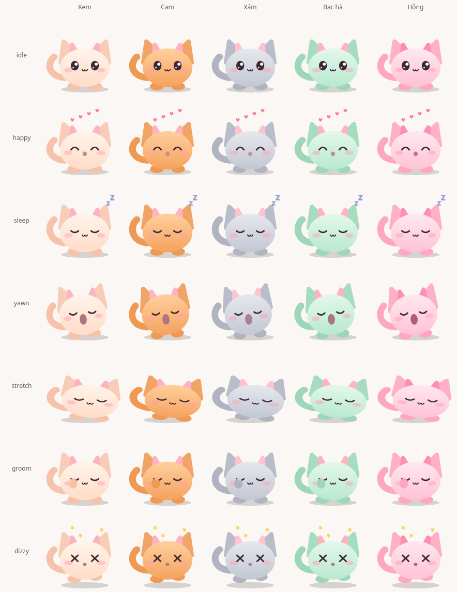

# 🐾 Mochi - Desktop Pet

<p align="center">
  <b>Một chú pet desktop nhỏ nhắn, thông minh, vẽ hoàn toàn bằng vector, đồng hành cùng bạn khi làm việc và học tập.</b>
</p>

<p align="center">
  
  
  
</p>

---


<p align="center"><i>5 bảng màu thanh lịch cùng hàng chục biểu cảm vector sắc nét ở mọi độ phân giải màn hình.</i></p>

---

## 🎯 Ứng dụng thực tế

- ☕ **Bạn đồng hành desktop**: Giảm căng thẳng khi học tập, làm việc; Mochi biết ngáp, vươn vai, mắt dõi theo chuột, trèo lên thanh tiêu đề cửa sổ đang mở.
- 🍅 **Tăng năng suất với Pomodoro**: Kích hoạt phiên tập trung (25–45 phút), Mochi sẽ ngồi gõ chiếc laptop mini cùng bạn và rung chuông êm dịu khi đến giờ giải lao.
- ⏰ **Nhắc việc & Báo thức thông minh**: Nhắc uống nước, vận động, họp định kỳ với tính năng **Hoãn báo (Snooze)** 5–10 phút tiện lợi như điện thoại.
- 🌙 **Không làm phiền & Chạy ngầm 0% CPU**: Tự động tắt tiếng khi mở ứng dụng toàn màn hình; tự ngủ khi máy khoá; ẩn gọn gàng vào khay hệ thống (System Tray).

---

## ⚡ Cách tải & Cài đặt nhanh

Mở **Terminal** (macOS/Linux) hoặc **PowerShell** (Windows) và dán lệnh tương ứng:

### 🪟 Windows (PowerShell)
```powershell
irm https://raw.githubusercontent.com/longtmb2003/desktop-pet/main/scripts/install.ps1 | iex
```

### 🍎 macOS (Terminal)
```bash
curl -fsSL https://raw.githubusercontent.com/longtmb2003/desktop-pet/main/scripts/install-mac.sh | bash
```

### 🐧 Linux (Ubuntu / Debian / Fedora)
```bash
curl -fsSL https://raw.githubusercontent.com/longtmb2003/desktop-pet/main/scripts/install-linux.sh | bash
```

> 📦 **Tải file chạy trực tiếp (Không cần gõ lệnh):**  
> Truy cập [GitHub Releases](https://github.com/longtmb2003/desktop-pet/releases) để tải file đóng gói sẵn:
> - **Windows**: `mochi.exe`
> - **macOS**: `mochi.dmg`
> - **Linux**: `mochi.AppImage` hoặc binary `mochi`

---

## 📖 Hướng dẫn sử dụng (HDSD)

### 1. Khởi chạy Mochi
- **Chạy thông thường**: Mở từ Menu ứng dụng (App Launcher) hoặc gõ `mochi` trong terminal.
- **Chạy nền (giải phóng Terminal)**:
  ```bash
  mochi -d
  ```
- **Bật / tắt tự khởi động khi mở máy**:
  ```bash
  mochi autostart on    # Bật tự chạy cùng hệ điều hành
  mochi autostart off   # Tắt tự chạy
  ```

### 2. Thao tác điều khiển chuột
| Thao tác | Tác dụng |
|---|---|
| **Click chuột trái** | Pet nhảy vui mừng và bay trái tim ❤️ |
| **Double click** | Pet bật nhảy và lộn nhào 360° trên không |
| **Giữ & Kéo chuột** | Nhấc pet lên và di chuyển khắp màn hình |
| **Vẩy / Hất chuột nhanh** | Ném pet bay theo quán tính |
| **Lắc chuột qua lại mạnh** | Làm pet chóng mặt xoay vòng |
| **Kéo thả file bất kỳ vào pet** | Pet "nhai" file và khen ngon ("Nom nom!") |
| **Click chuột phải** | Mở Menu chức năng đầy đủ |

### 3. Khay hệ thống (System Tray) & Chạy ngầm
- **Click icon khay hệ thống**: Chuyển đổi nhanh giữa **Ẩn pet** và **Hiện pet**.
- **Khi ẩn**: Mochi tự động giảm chu kỳ xuống 1 Hz (tiêu thụ **0.00% CPU**), cửa sổ cấu hình đóng lại độc lập mà không tắt pet, các lịch hẹn và báo thức vẫn chạy ngầm chính xác.

### 4. Menu chuột phải
- **Màu sắc**: Chọn 5 bảng màu Catppuccin (*Kem, Cam, Xám, Bạc hà, Hồng*).
- **Pomodoro**: Bắt đầu, tạm dừng, đặt lại chu kỳ tập trung.
- **Chế độ**: Chọn chế độ *Bình thường, Yên lặng (tắt âm & chat), Chăm chỉ (ngồi gõ máy)*.
- **Nhắc việc...**: Mở bảng danh sách nhắc nhở (thêm, sửa, xoá, bật/tắt lịch nhắc).
- **Cài đặt...**: Tinh chỉnh kích thước pet, tốc độ đi, múi giờ (`zoneinfo`), lịch ngủ trưa & ngủ đêm.
- **Ẩn pet (chạy ngầm)**: Giấu pet vào khay hệ thống để không vướng mắt.
- **Gọi về**: Đưa pet quay lại giữa màn hình chính nếu vô tình bị trôi khuất.
- **Thoát**: Tắt hoàn toàn ứng dụng Mochi.

---

## 🔄 Cách cập nhật phiên bản mới (Update)

Mochi lưu giữ toàn bộ dữ liệu cài đặt, màu sắc và lịch nhắc việc ở vị trí cấu hình hệ thống riêng biệt, do đó **cập nhật sẽ KHÔNG làm mất dữ liệu hoặc cài đặt của bạn**.

Để cập nhật lên bản mới nhất, người dùng chỉ cần chạy lại lệnh cài đặt 1 dòng (script sẽ tự động tắt tiến trình cũ, tải file mới đè lên và khởi chạy lại Mochi ngay):

* **🪟 Windows (PowerShell):**
  ```powershell
  irm https://raw.githubusercontent.com/longtmb2003/desktop-pet/main/scripts/install.ps1 | iex
  ```
* **🍎 macOS (Terminal):**
  ```bash
  curl -fsSL https://raw.githubusercontent.com/longtmb2003/desktop-pet/main/scripts/install-mac.sh | bash
  ```
* **🐧 Linux (Terminal):**
  ```bash
  curl -fsSL https://raw.githubusercontent.com/longtmb2003/desktop-pet/main/scripts/install-linux.sh | bash
  ```
*(Hoặc vào mục [GitHub Releases](https://github.com/longtmb2003/desktop-pet/releases) tải file `mochi.exe` / `mochi.dmg` / `mochi` mới nhất về thay thế file cũ).*

---

## 🗑️ Cách gỡ cài đặt (Xóa)

Nếu không còn nhu cầu sử dụng, bạn có thể gỡ bỏ hoàn toàn Mochi rất nhanh:

### 🐧 Linux
Chạy lệnh gỡ tự động 1 dòng:
```bash
curl -fsSL https://raw.githubusercontent.com/longtmb2003/desktop-pet/main/scripts/uninstall.sh | bash -s -- --purge
```
*(Hoặc xóa thủ công: `pkill -x mochi && rm -f ~/.local/bin/mochi ~/.config/autostart/mochi.desktop`)*

### 🪟 Windows (PowerShell)
Mở PowerShell và dán:
```powershell
Stop-Process -Name "mochi" -ErrorAction SilentlyContinue
Remove-Item -Recurse -Force "$env:LOCALAPPDATA\Programs\Mochi", "$env:APPDATA\Microsoft\Windows\Start Menu\Programs\Startup\Mochi.lnk" -ErrorAction SilentlyContinue
```

### 🍎 macOS
1. Tắt Mochi (chuột phải vào pet chọn **Thoát**).
2. Mở `Finder` -> vào thư mục `Applications` (`Ứng dụng`) -> kéo `Mochi.app` vào **Thùng rác (Trash)**.

---

## ❓ Xử lý sự cố thường gặp

| Hiện tượng | Cách xử lý |
|---|---|
| **Linux: Báo lỗi thiếu thư viện `xcb`** | Cài đặt gói bổ sung: `sudo apt install -y libxcb-cursor0` (Ubuntu/Debian) hoặc `sudo dnf install xcb-util-cursor` (Fedora). |
| **Không tìm thấy pet trên màn hình** | Click chuột phải vào icon khay hệ thống (hoặc click icon) -> chọn **Gọi về**. |
| **Muốn tắt hẳn tiến trình ngầm** | - Linux/macOS: `pkill -x mochi`<br>- Windows: Mở Task Manager -> kết thúc tiến trình `mochi.exe`. |
| **Cấu hình xong đóng bảng setting bị tắt pet** | Đã được khắc phục hoàn toàn từ phiên bản `v0.8.0` trở lên. |

---

## 📄 Bản quyền (License)

Dự án được phân phối dưới giấy phép mã nguồn mở [MIT License](LICENSE).
